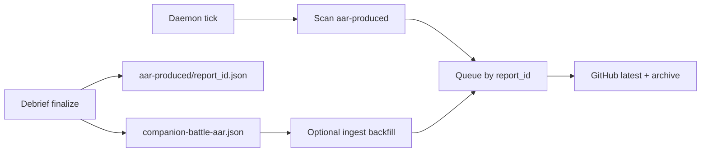

# ASTER-M1-AAR-DURABILITY-02 — AAR offline durability & archive identity

**Date:** 2026-11-15  
**Mode:** Correctness fix — no commits, pushes, live publish, or runtime deploy.  
**Baselines:** [ASTER-M1-AAR-IMPLEMENT-01](./ASTER-M1-AAR-IMPLEMENT-01.md), [ASTER-M1-AAR-RELAY-01](./ASTER-M1-AAR-RELAY-01.md)

---

## 1. Findings — data-loss scenario

**Verdict: CONFIRMED (pre-fix).**

| Step | Risk |
|------|------|
| Engine writes only `companion-battle-aar.json` | Single-slot “latest” pointer |
| Relay copies from that file into `aar-pending/` on daemon ingest | Copy happens **after** debrief, only if daemon is running |
| Mission B debrief while daemon offline | Overwrites `companion-battle-aar.json` → **mission A report unrecoverable** |

The relay queue could not backfill reports the engine never persisted independently.

---

## 2. Fix (smallest reliable)

### Producer (engine)

On each successful finalize:

1. **`companion-battle-aar.json`** — unchanged (latest pointer for operators/tools).
2. **`aar-produced/<report_id>.json`** — **new** durable per-mission artifact (`report_id` = stable SHA-256 identity). Same bytes, atomic write, directory created once.

File: `engine/OpenXcom/src/Engine/CompanionBattleAarCapture.cpp`

### Consumer (Node relay — existing daemon)

Each tick **before** on-demand work:

1. **`discoverProducedAarArtifacts()`** — scan `aar-produced/*.json`; validate; enqueue unpublished `report_id`s (FIFO sorted by `finalized_at_ms`).
2. **`ingestLocalBattleAar()`** — still reads latest pointer; backfills `aar-produced/<report_id>.json` only if legacy engine omitted it.
3. Queue entries reference **`aar-produced/`** artifacts (no destructive delete on publish — local retention until operator policy).

### Archive path collision

Archive path was `m0/aar/<campaign_id>/<mission_statistics_id>.json` — **collides** when reloading an older save reuses statistics indices.

**New path:** `m0/aar/<campaign_id>/<tactical_battle_id_sanitized>/<mission_statistics_id>.json`

File: `companion/m0-publish/lib/battle-aar-relay-publish.cjs` (`archiveRelPath`)

---

## 3. Changed files

| File | Change |
|------|--------|
| `engine/OpenXcom/src/Engine/CompanionBattleAarCapture.cpp` | Durable `aar-produced/<report_id>.json` write |
| `companion/m0-publish/lib/battle-aar-relay-publish.cjs` | Discover scan, produced artifacts, archive path, queue ordering |
| `companion/m0-publish/test/companion-battle-aar-relay.test.cjs` | Archive path + `aar-produced` expectations |
| `companion/m0-publish/test/companion-battle-aar-durability.test.cjs` | **New** durability suite |

**Unchanged:** relay daemon entrypoint, `m0/state.json` / `base-state.json` isolation, gameplay.

---

## 4. Focused test results

```text
node --test test/companion-battle-aar-relay.test.cjs test/companion-battle-aar-durability.test.cjs
# 14/14 pass
```

| Scenario | Result |
|----------|--------|
| Daemon offline; two missions in `aar-produced/` | Both discovered on restart; both archived |
| Latest relay doc | Last published = newest `finalized_at_ms` |
| Duplicate discovery | No extra queue rows |
| Same `mission_statistics_id`, different `tactical_battle_id` | Distinct archive paths |
| Failed GitHub upload | Queue retained; `aar-produced/` file retained |
| Stale `companion-battle-aar.json` | Discovery still publishes from `aar-produced/` |

**Engine harness:** not re-run in this step (no full mission). Producer change is localized to finalize write path.

---

## 5. Publication lifecycle (updated)



---

## 6. Remaining risks

| Risk | Mitigation / note |
|------|-------------------|
| Engine not rebuilt before live play | Older binary writes only latest file — daemon backfills **one** report from latest at ingest; offline multi-mission still needs rebuilt engine |
| Disk growth in `aar-produced/` | No auto-prune yet; journal tracks publish — operator cleanup policy TBD |
| Payload > 768 KiB | Entry stays queued; produced file preserved |
| `aar-pending/` legacy copies | No longer created; harmless if present from older relay |
| Archive path change | New missions use 3-segment path; old 2-segment archives remain on GitHub if any were published in tests |

---

## 7. Live deployment readiness

| Item | Status |
|------|--------|
| Node relay durability | **Ready** after owner review |
| Engine `aar-produced` | **Requires** rebuilt `openxcom` (not deployed in this step) |
| Live GitHub verify | **Not run** (per stop condition) |

**Stop condition met.** Owner review before engine binary pin update and live relay verification.