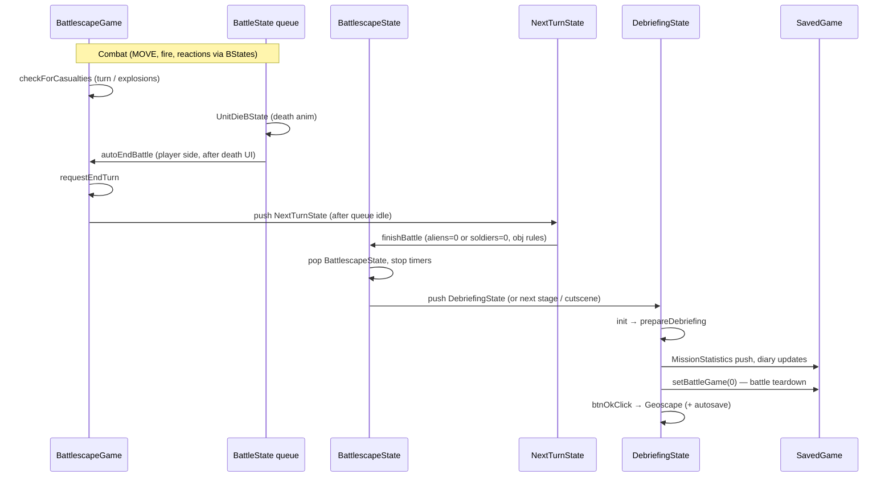

# ASTER-M1-AAR-LIFECYCLE-AND-CONTRACT-AUDIT-01

**Date:** 2026-11-14  
**Mode:** Read-only architecture / data-contract audit — no production changes, builds, commits, or relay publishes.  
**Evidence base:** `engine/OpenXcom/src` (canonical tree), `companion/m0-publish`, prior audits (`ASTER-M1-POST-MISSION-RELIABILITY-AUDIT-01.md`, `ASTER-M1-C9-C10-RELIABILITY-RECONCILIATION-01.md`, `ASTER-M1-STRATEGIC-INTEL-COVERAGE-01.md`, B4/B7/B8 audits), relay scratch snapshots under `local/m0/audits/.relay-scratch/`.

---

## 1. Executive feasibility verdict

**Verdict: FEASIBLE — two-phase capture is required and aligns with verified engine behavior.**

A dedicated `m0/battle-aar.json` artifact can be produced **without** overwriting `m0/state.json`, **without** manual F6, and **after** the player returns to Geoscape, provided implementation follows this contract:

| Requirement | Feasibility | Basis |
|-------------|-------------|--------|
| Preserve perishable tactical logs (event/perception) | **Yes** — must copy from `SavedBattleGame` before `setBattleGame(0)` | Logs are in-memory only (not in save YAML) |
| Authoritative mission score / recovery / MIA-KIA | **Yes** — read from `DebriefingState` / `MissionStatistics` after `prepareDebriefing()` | Engine owns scoring; Node must not recompute |
| Survive Battlescape → Geoscape | **Yes** — durable local staging + existing sidecar daemon | Same pattern as tactical/strategic SEND |
| Independent of live `state.json` | **Yes** — separate relay path (`publishRelayDocument`) | Mirrors `m0/base-state.json` |
| Fair-play (B4/B7) | **Yes** — reuse perception export rules | No new omniscience |
| Fully automatic GitHub publish at mission end | **Conditional** — needs engine hook + watcher lane; no hook exists today | Owner decision on auto vs Geoscape-acknowledged publish |

**Not feasible without new engine work:** single-phase “one snapshot at mission end” that includes both debrief score and full tactical logs — debrief mutates battle (`prepareDebriefing`) and clears the battle (`setBattleGame(0)`) after scoring.

---

## 2. Verified engine lifecycle

Verified call graph (simplified). Numbers reference the **logical** order players experience; some steps can interleave across frames while `BattleState` queue drains.



### 2.1 Mission-ending conditions (verified)

| Trigger | Source | `finishBattle` args | Notes |
|---------|--------|---------------------|--------|
| All hostiles eliminated (non `MUST_DESTROY`) | `NextTurnState::close` | `abort=false`, `liveSoldiers` | Only after **turn transition** UI, not instant on last kill |
| Squad wiped (`liveSoldiers == 0`) | Same | `abort=false`, `0` | Lose path |
| `MUST_DESTROY` objectives complete | `BattlescapeGame::processTurn` | `abort=false`, `liveSolders` | Can end **without** clearing all aliens |
| Turn limit / chrono | `BattlescapeGame::processTurn` | `abort` per `ChronoTrigger` | `FORCE_ABORT`, `FORCE_WIN`, `FORCE_LOSE` |
| Player abort | `AbortMissionState` | `abort=true`, soldiers in exit | Partial extraction rules in `prepareDebriefing` |
| Multi-stage deployment | `BattlescapeState::finishBattle` | **No debrief** — `BriefingState` + `nextStage` | AAR must be **per stage** or deferred until final stage |

**Mid-turn last kill:** `UnitDieBState` (player turn) calls `autoEndBattle()` → `requestEndTurn()`; mission does not end until the state queue idles and `NextTurnState` runs (`UnitDieBState.cpp` ~210–214, `BattlescapeGame.cpp` ~1932–1939, `NextTurnState.cpp` ~178–180).

**Reaction fire / chained shots:** Resolved inside the `BattleState` list (`BattlescapeGame::think` drains `_states`). `CompanionSnapshot::tryExport` runs only when `_states.empty()` and player side (`BattlescapeGame.cpp` ~1297–1300) — useful for **live** snapshots, not a substitute for mission-close capture.

### 2.2 Casualties and kill accounting

- `BattlescapeGame::checkForCasualties` updates morale, records `BattleUnitKills` on murderer statistics, drives UI (`BattlescapeGame.cpp` ~633+).
- Kill rows use `killStat.mission = getMissionStatistics()->size()` at death time (next mission index) (~688–689).
- Companion **perception** attribution: `resolveCombatCasualtyAttributionExport` in `CompanionPerceptionLogCore.cpp` — visible fatal actor, roster/hostile victims; neutrals gated; no inference from audio/proximity.

### 2.3 Debriefing and authoritative outcome

| Step | When | What is finalized |
|------|------|-------------------|
| `DebriefingState` ctor | Battle UI popped | New `MissionStatistics` allocated |
| `prepareDebriefing()` | First `init()` | Recovery, KIA/MIA flags, craft/base, `success`, unit iteration — **mutates** `SavedBattleGame` |
| Score list loop in `init()` | After `prepareDebriefing` | `_stats` quantities → `total`, `rating`, `_missionStatistics->score` |
| `getMissionStatistics()->push_back` | `init()` ~448–449 | Persistent mission row in save |
| `setBattleGame(0)` | `init()` ~631 | **Battle destroyed** — tactical map / units / companion logs gone |
| `btnOkClick` | Operator leaves debrief | Promotions, containment errors → Geoscape |

**Authoritative outcome window:** After the score loop in `DebriefingState::init()` (rating + total assigned, ~418–442) and **before** `setBattleGame(0)` (~631).

**Not exported today:** `DebriefingState` / `MissionStatistics` / per-line `DebriefingStat` are **not** written by any `Companion*Export` module (confirmed: no matches in `CompanionBaseIntelligenceExportCore.cpp`).

### 2.4 Equipment recovery and personnel

All handled inside `prepareDebriefing()` (~786+): items to craft/base, `_stats` rows (`STR_ALIENS_KILLED`, `STR_LIVE_ALIENS_RECOVERED`, civilian lines, MIA, etc.), wound recovery → `injuryList`, promotions queued via `handlePromotions` after init score pass.

### 2.5 Return to Geoscape

`btnOkClick` pops debrief, may push commendations/promotions/storage UI, then autosave on Geoscape (`DebriefingState.cpp` ~683–730). **Geoscape SEND** exports `companion-base-intelligence-send.json` → `m0/base-state.json` only — **no mission debrief block** (`strategic-publish.cjs`, prior C10 audits).

### 2.6 Companion tactical export today (F6 / idle)

- `CompanionBriefingRequest` + F6 → `CompanionSnapshot::tryExport` → `local/m0/tactical-live.yaml`.
- Gated: player turn, not falling, not debug, `OPENXCOM_COMPANION_SNAPSHOT_PATH` set (`CompanionSnapshot.cpp` ~1136–1157).
- **No** automatic export on `finishBattle` or debrief.

---

## 3. Capture-before-teardown / finalize-after-debrief design

### 3.1 Why two phases

| Phase | Timing | Captures | Must not assume |
|-------|--------|----------|-----------------|
| **A — Tactical terminal** | Start of `prepareDebriefing()` (battle intact, logs full) | `eventLog`, `perceptionLog`, unit terminal states, `missionContext`, `tactical_battle_id`, `sessionId` | Mission score, recovery quantities, post-debrief roster |
| **B — Outcome finalize** | After debrief score loop in `DebriefingState::init()`, before `setBattleGame(0)` | `MissionStatistics`, `_stats` breakdown, `success`, `rating`, promotions flags, `injuryList` | Live battle map (still present until line ~631) |

Phase A **before** `prepareDebriefing` is critical: abort/recovery logic changes positions, items, and soldier status.

### 3.2 Safest hook points (P0 recommendation)

1. **Engine — Phase A:** `CompanionBattleAarCapture::capturePhaseA(SavedGame*, SavedBattleGame*)` called as **first statement** of `DebriefingState::prepareDebriefing()`.
   - Serialize bounded copy of logs + roster unit terminal snapshot to `local/m0/companion-battle-aar-phase-a.json` (or in-memory buffer passed to Phase B).
2. **Engine — Phase B:** `CompanionBattleAarCapture::finalizeAndWrite(SavedGame*, MissionStatistics*, DebriefingState& stats access)` at end of `DebriefingState::init()` after `_missionStatistics->score` / `rating` set, **before** `setBattleGame(0)`.
   - Merge Phase A + outcome; set `status: "finalized"`; write `local/m0/companion-battle-aar.json`.
3. **Node — publish:** Extend `companion-on-demand-relay.cjs` (or parallel watcher) to detect finalized local artifact and `publishRelayDocument` → `m0/battle-aar.json` (separate from `publishRelayState` for tactical).

### 3.3 Cutscene / deferred `init()` edge case

`finishBattle` may push `CutsceneState` **after** `DebriefingState` (`BattlescapeState.cpp` ~2172–2177). `DebriefingState::init()` may run only when debrief becomes active. Phase A/B hooks tied to `init()` remain correct; wall-clock delay between battle end and capture is acceptable **if** local Phase A file is written synchronously at start of `prepareDebriefing`.

### 3.4 Multi-stage missions

When `nextStage` is non-empty and exit conditions met, debrief is skipped (`BattlescapeState.cpp` ~2139–2147). **AAR policy:** either suppress final AAR until last stage, or emit `stage_complete` partial reports keyed by `(tactical_battle_id, stage_index)` — **owner decision** (§11).

---

## 4. Field-to-source mapping

Legend: **Auth** = authoritative engine; **Perc** = perception-limited; **New** = not present today.

| AAR field (proposed) | Engine source | Lifecycle | Exported today? | Auth/Perc | New work |
|----------------------|---------------|-----------|---------------|-----------|----------|
| `identity.campaign_id` | `SavedGame::getCompanionCampaignId()` | Debrief+ | BI export only | Auth | Wire into AAR |
| `identity.tactical_battle_id` | `SavedBattleGame::getCompanionTacticalBattleId()` | Whole battle | Sidecar / save YAML | Auth | Include in AAR |
| `identity.tactical_session_id` | `CompanionEventLog::getSessionId()` | Battle | F6 snapshot | Auth binding | Phase A |
| `identity.mission_statistics_id` | `MissionStatistics::id` after push | Debrief init | Save YAML | Auth | Phase B |
| `identity.mission_type` | `SavedBattleGame::getMissionType()` | Battle | `missionContext` | Auth | Phase A |
| `identity.region` / `country` | `MissionStatistics` | Debrief | No | Auth | Phase B |
| `identity.marker_name` / `marker_id` | `MissionStatistics` | Debrief | No | Auth | Phase B |
| `identity.game_time` | `MissionStatistics::time` | Debrief | No | Auth | Phase B |
| `identity.mission_start_time` | — | — | **Not recorded** | — | **Optional extension** (mission load timestamp) |
| `outcome.aborted` | `SavedBattleGame::isAborted()` | Debrief | No | Auth | Phase B |
| `outcome.success` | `MissionStatistics::success` | After `prepareDebriefing` | No | Auth | Phase B |
| `outcome.score` | `MissionStatistics::score` | Debrief init | No | Auth | Phase B |
| `outcome.rating` | `MissionStatistics::rating` | Debrief init | No | Auth | Phase B |
| `outcome.score_breakdown[]` | `DebriefingStat` (`item`, `qty`, `score`) | Debrief init | No | Auth | Phase B — **export STR ids**, not localized text |
| `outcome.aliens_killed` (derived) | From breakdown row `STR_ALIENS_KILLED` | Debrief | No | Auth | Phase B |
| `outcome.civilian_*` | Breakdown rows | Debrief | No | Auth | Phase B |
| `outcome.loot_value` | `MissionStatistics::lootValue` | Debrief | No | Auth | Phase B |
| `outcome.valiant_crux` | `MissionStatistics::valiantCrux` | Debrief | No | Auth | Phase B |
| `tactical_terminal.units[]` | `BattleUnit` at Phase A | Pre-`prepareDebriefing` | Partial in F6 | Auth tactical | Phase A subset |
| `tactical_terminal.perception_log` | `CompanionPerceptionLog` | In-memory | F6 | Perc | Phase A copy |
| `tactical_terminal.event_log` | `CompanionEventLog` | In-memory | F6 | Perc (player fire) | Phase A copy |
| `tactical_terminal.roster_casualty_summary` | Perception ledger | Battle | F6 | Auth episodes | Phase A |
| `soldiers_post_debrief[]` | `BattleUnit` + `Soldier` after prepare | Debrief | No | Auth | Phase B — KIA/MIA, wounds, stat deltas |
| `soldiers_post_debrief[].kills[]` | `BattleUnitStatistics::kills` | Battle | Save (diary) | Auth engine stats | Phase B |
| `equipment_recovery[]` | `_recoveryStats` / craft transfer | Debrief | No | Auth | Phase B |
| `promotions_pending` | `_promotions` flag | Debrief | No | Auth | Phase B optional |

**Do not duplicate in Node:** summing `_stats` scores, casualty counts from perception alone, or rating strings from thresholds (use engine outputs).

---

## 5. Proposed AAR JSON contract

**Envelope** (machine-readable; suitable for ChatGPT consumption). Placeholders only — **not** sample mission evidence.

```json
{
  "schema_version": 1,
  "type": "battle_aar",
  "status": "finalized",
  "report_id": "<proposed: sha256 hex over canonical identity fields>",
  "generation_id": "<proposed: uuid per finalize attempt for idempotent relay>",
  "published_at": null,
  "identity": {
    "campaign_id": "<from SavedGame>",
    "tactical_battle_id": "<from SavedBattleGame>",
    "tactical_session_id": "<from eventLog.sessionId>",
    "mission_statistics_id": "<int, post-push>",
    "mission_type": "<deployment id string>",
    "mission_class": "<derived, optional>",
    "region": "<rules id or null>",
    "country": "<rules id or null>",
    "marker_name": "<optional>",
    "marker_id": "<optional>",
    "game_time": { "year": 0, "month": 0, "day": 0, "hour": 0, "minute": 0 }
  },
  "outcome": {
    "aborted": false,
    "success": false,
    "score": 0,
    "rating": "<STR_RATING_* key>",
    "score_breakdown": [
      { "line_id": "<STR_* debrief key>", "quantity": 0, "points": 0, "recovery": false }
    ],
    "provisional": false
  },
  "tactical_terminal": {
    "captured_at_phase": "pre_prepare_debriefing",
    "turn": 0,
    "side": 0,
    "event_log": {
      "sessionId": "<string>",
      "oldestSeq": 0,
      "latestSeq": 0,
      "droppedCount": 0,
      "events": []
    },
    "perception_log": {
      "sessionId": "<string>",
      "events": [],
      "roster_casualty_summary": { "schemaVersion": 1, "entries": [] }
    },
    "units_terminal": [
      {
        "unit_id": 0,
        "soldier_id": "<geoscape id or null>",
        "display_name": "<if known>",
        "status": "<engine enum string>",
        "health": 0,
        "fatal_wounds": 0,
        "stun_level": 0,
        "time_units": 0,
        "position": { "x": 0, "y": 0, "z": 0, "position_known": true },
        "in_exit_area": false,
        "kia": false,
        "mia": false,
        "note": "terminal_tactical — not post-debrief roster state"
      }
    ],
    "mission_context": { "schemaVersion": 1, "missionType": "<string>", "missionClass": "<string>" },
    "log_retention_note": "event_log and perception_log are bounded rings; droppedCount > 0 means older events unavailable, not zero events."
  },
  "post_debrief": {
    "injury_list": { "<soldier_id>": 0 },
    "soldier_stat_deltas": [],
    "equipment_recovery": [],
    "promotions_scheduled": false
  },
  "attribution_policy": {
    "kill_credit_source": "engine BattleUnitStatistics + debrief stats",
    "perception_kill_credit": "combat_casualty_attributed only when fair-play gates pass",
    "neutral_civilian_fatal": "omitted from B4 export by policy"
  },
  "data_quality": {
    "missing_fields": [],
    "unknown_vs_zero": "Use null for unknown; use 0 only when engine affirms zero."
  }
}
```

**`status` values:** `phase_a_staged` → `finalized` → `publish_pending` → `published` | `publish_failed` (local journal tracks transitions).

**`report_id` (duplicate prevention):** Canonical JSON of `{campaign_id, tactical_battle_id, mission_statistics_id}` hashed — matches save-backed mission index.

---

## 6. Reaction-fire and kill-attribution coverage

### 6.1 Reaction vs player-ordered fire

| Channel | Reaction distinguished? | Mechanism |
|---------|-------------------------|-----------|
| `perceptionLog` | **Yes** | Distinct type `reaction_attack_executed` (`CompanionPerceptionLog.cpp` ~387); fair-play may omit `subjectUnitId` when actor not visible |
| `eventLog` (`weapon_fired`) | **No** | Records deliberate **player-ordered** weapon fire only (`action.playerOrdered`, `CompanionEventLog.cpp` ~16–30) |

**Smallest extension (P1):** None required for perception-first AAR narrative. **Optional P2:** add `player_ordered: true/false` on `weapon_fired` if engine can pass flag from `BattleAction` for AI-owned soldiers — today many AI shots are absent from `eventLog`.

### 6.2 Kill attribution classes

| Class | Source | AAR treatment |
|-------|--------|---------------|
| Engine-confirmed | `BattleUnitStatistics::kills`, debrief stat lines | `post_debrief.soldiers[].kills`, breakdown quantities |
| Player-observed | `combat_casualty_attributed`, `soldier_down` | `tactical_terminal.perception_log` with `confidence` / `attributionScope` |
| Unattributed | Hidden actor explosions, audio-only gunfire | Explicitly **absent** — mark `data_quality.missing_fields`, never zero-fill |

**B7:** Explosion rows may lack shooter `subjectUnitId`; `explosion_origin_class` documents fair-play classification — preserve in AAR without inferring killers.

**B8:** `weapon_fired` / `reaction_attack_executed` do not carry displayed accuracy; `displayedFiringAccuracy` lives on snapshot `actionCosts` at export instants — optional cross-reference only, not AAR-authoritative hit probability.

---

## 7. Relay publishing and durability plan

### 7.1 Current architecture (relevant pieces)

| Component | Role |
|-----------|------|
| `companion-on-demand-relay.cjs` | Processes on-demand SEND; tactical → `publishRelayState` → `m0/state.json` |
| `briefing-watcher.cjs` | F6 request journal + `publishRelayWithManualFallback` |
| `strategic-publish.cjs` | Geoscape SEND → `publishRelayDocument` → `m0/base-state.json` |
| `github-relay.cjs` | `publishRelayState` vs `publishRelayDocument` (path override) |
| `briefing-relay-publish.cjs` | Manual export on shrink exhaustion, atomic local artifacts |

**`battle-aar.json` is not in `RELAY_CONTENT_PATHS` today** — add `battleAar: 'm0/battle-aar.json'` to relay config (implementation).

### 7.2 Recommended durability flow

1. **Engine** writes `local/m0/companion-battle-aar.json` atomically (same pattern as `CompanionSnapshotExportCore::writeSnapshotAtomically`).
2. **Marker:** `local/m0/companion-battle-aar-publish-request.json` with `{ report_id, generation_id, content_sha256, finalized_at_ms }`.
3. **Watcher** (extend existing sidecar, not new service):
   - Poll marker; validate JSON schema + `status === "finalized"`.
   - Build relay envelope: `{ schema_version, type: "battle_aar", ...payload, snapshot_sha256, published_at }`.
   - `publishRelayDocument(relay, { statePath: 'm0/battle-aar.json' })`.
   - Journal success/failure (`battle-aar-journal.json`) for retries.
4. **Idempotency:** Skip remote PUT if `report_id` matches remote and SHA unchanged (mirror tactical `remote_unchanged` semantics).
5. **Failure:** Keep local finalized file; set `publish_failed` with reason; retry on daemon tick or next Geoscape SEND (owner choice).

### 7.3 Independence from `state.json`

- Never call `buildRelayPayload` / `publishRelayState` for AAR.
- Last F6 tactical snapshot may be **stale** relative to terminal battle — AAR must cite `tactical_terminal` + `outcome`, not assume live `m0/state.json`.

### 7.4 Campaign confusion guard

Bind relay payload to `identity.campaign_id` + `tactical_battle_id` + `mission_statistics_id`. Reject publish if `campaign_id` ≠ current save’s id (Node validator). Optional: include `companion_build_sha256` pin for support.

### 7.5 Incomplete report guard

Do not publish when `status !== "finalized"` or Phase A file exists without Phase B merge. UI/relay consumers treat `phase_a_staged` as **non-authoritative**.

---

## 8. Missing information and confirmed limitations

### 8.1 Accuracy/completeness Q&A

| # | Question | Answer |
|---|----------|--------|
| 1 | Final-action kill omitted from AAR? | **Tactical perception:** unlikely if Phase A runs at `prepareDebriefing` start (after state queue drained). **Engine kill list:** included in Phase B from `BattleUnitStatistics`. **Perception-only consumer:** last events may be missing if ring dropped (`droppedCount > 0`) — document as unknown, not zero. |
| 2 | Reaction after capture but before termination? | **No** for Phase A at `prepareDebriefing` — combat queue finished before `finishBattle`. Risk if Phase A mistakenly taken earlier (e.g. idle `tryExport` on second-to-last alien). |
| 3 | Soldier alive in AAR but dead in campaign? | **Possible** if comparing `tactical_terminal` to `post_debrief` — fatal wounds/bleed-out are resolved in prepare/debrief. AAR must label `tactical_terminal` vs `post_debrief` separately. |
| 4 | Score differs from debrief screen? | **Should not** if Phase B reads same `_missionStatistics` / `_stats` as UI. Node recomputation would be a defect. |
| 5 | Prior battle’s AAR mistaken for current? | Prevented by `report_id` + journal + campaign_id check. |
| 6 | Unavailable events reported as zero? | Prevented by `data_quality` + `log_retention_note`; export `droppedCount`, `oldestSeq`. |

### 8.2 Confirmed gaps (not bugs)

- No debrief export in strategic BI (C10 scope).
- `eventLog` does not record hit/miss or alien shots.
- Civilian/neutral fatals omitted from B4 attribution export by policy.
- Mission start wall-clock timestamp not stored.
- Multi-stage missions skip debrief until final stage.
- `CompanionEventLog` / `CompanionPerceptionLog` **not** in savegame — battle reload loses pre-capture logs unless Phase A persisted.

### 8.3 Historical / design docs

Prior audits already separate channels (tactical snapshot, BI, perception ledger) without unified AAR (`ASTER-M1-C9-C10-RELIABILITY-RECONCILIATION-01.md`). This audit **does not** change that scope — it specifies the missing artifact.

---

## 9. Minimal implementation sequence

### P0 — Correctness

1. Engine Phase A capture at `prepareDebriefing()` entry (logs + terminal units + ids).
2. Engine Phase B merge at end of `DebriefingState::init()` before `setBattleGame(0)` — attach `MissionStatistics` + non-localized `score_breakdown`.
3. Local atomic write + `report_id` / `status: finalized`.
4. Node schema validator + `publishRelayDocument` to `m0/battle-aar.json`.
5. Sidecar watcher + journal + idempotent retry.
6. Tests (§10) in harness before live mission.

### P1 — Reporting completeness

1. Preserve full perception/event rings with `droppedCount` / seq bounds.
2. Include `BattleUnitStatistics::kills` per soldier in `post_debrief`.
3. Document reaction coverage (`reaction_attack_executed` vs `weapon_fired`).
4. Optional Geoscape SEND co-publish trigger after debrief OK (auto relay without F6).

### P2 — Optional enhancements

1. Narrative `summary_bullets[]` generated in Node from structured fields (no new engine logic).
2. Link to last `m0/state.json` `snapshot_id` if sha referenced in Phase A metadata.
3. Campaign ledger update at AAR finalize (`M1-campaign-intelligence-ledger-audit.md` alignment).
4. Screenshots remain optional attachments, not authoritative.

---

## 10. Focused validation plan

| Test | Layer | Fixture |
|------|-------|---------|
| Successful UFO ground mission | Engine harness + Node | Mock `DebriefingState::init` with battle save |
| Final alien kill + reaction log retained | Engine | `companion_snapshot_serialization_test` patterns + forced reaction fixture |
| `MUST_DESTROY` end with aliens alive | Engine | Objective-only victory |
| Abort with partial exit | Engine | `AbortMissionState` path |
| Squad wipe | Engine | `liveSoldiers == 0` |
| Score/recovery match debrief stats | Engine | Compare exported AAR to `MissionStatistics::save()` |
| Phase A before mutation | Engine | Assert unit positions/items differ pre/post `prepareDebriefing` |
| `setBattleGame(0)` safety | Engine | Capture still works when battle nulled after export |
| Duplicate publish / retry | Node | `companion-on-demand-relay` style journal test |
| `campaign_id` / `tactical_battle_id` binding | Node + Engine | `companion_tactical_ownership_test` ids |
| `state.json` untouched | Node | Publish AAR → assert no tactical PUT |
| Multi-stage skip debrief | Engine | `nextStage` deployment — expect no `finalized` AAR |

**Live mission (later):** One cooperative terror/UFO mission verifying GitHub `m0/battle-aar.json` after Geoscape return without F6.

**No full campaign playthrough required.**

---

## 11. Risks and questions requiring owner decisions

1. **Auto-publish timing:** Publish immediately after debrief finalize (engine enqueue) vs only after operator reaches Geoscape / optional SEND?
2. **Multi-stage missions:** One AAR per stage vs single composite when final stage completes?
3. **Payload size:** Full `tactical_terminal.units` + logs may exceed relay caps — adopt adaptive shrink / manual export fallback for AAR like tactical terrain?
4. **Abort UX:** If player never clicks debrief OK, AAR is finalized in `init()` but Geoscape publish may be delayed — is that acceptable?
5. **Neutral/civilian storytelling:** Keep B4 omission in AAR or add non-attributed fatality counts from debrief stats only (no perception inference)?
6. **Binding to last `state.json`:** Should AAR reference last relay tactical `snapshot_sha256` when available, or remain fully self-contained?
7. **OxCE vs OpenXcom parity:** Audit traced canonical `engine/OpenXcom`; Meridian/OXCE forks may diverge on debrief — confirm target runtime pin for implementation.

---

## References (source anchors)

| Topic | Location |
|-------|----------|
| Battle end / turn flow | `BattlescapeGame.cpp`, `NextTurnState.cpp`, `UnitDieBState.cpp` |
| Debrief / score | `DebriefingState.cpp` (`prepareDebriefing`, `init`, `setBattleGame(0)`) |
| Mission statistics schema | `MissionStatistics.h` |
| Tactical snapshot / logs | `CompanionSnapshot.cpp`, `CompanionPerceptionLog.h` (`MAX_RETAINED = 256`), `CompanionEventLog.h` |
| Fair-play attribution | `CompanionPerceptionLogCore.cpp` |
| Tactical relay | `tactical-publish.cjs` (`buildRelayPayload`), `companion-on-demand-relay.cjs` |
| Strategic relay | `strategic-publish.cjs`, `relay-config.cjs` |
| Campaign identity | `CompanionBaseIntelligenceExportCore.cpp`, `SavedBattleGame::getCompanionTacticalBattleId()` |

---

**Stop condition met:** Read-only audit deliverable for owner review. No implementation authorized in this document.