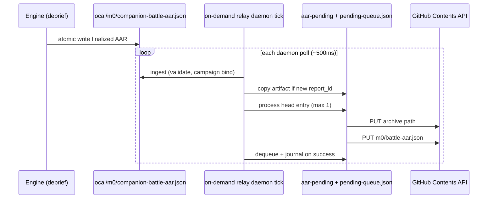

# ASTER-M1-AAR-RELAY-01 — Automatic battle AAR GitHub relay

**Date:** 2026-11-15  
**Mode:** Node relay implementation only — no commits, pushes, live `gh` publish, or engine binary changes.  
**Baseline:** [ASTER-M1-AAR-IMPLEMENT-01.md](./ASTER-M1-AAR-IMPLEMENT-01.md)

---

## Summary

The existing **companion on-demand relay daemon** now watches `companion-battle-aar.json` on every poll tick, enqueues durable copies, and publishes **one** pending report per tick to GitHub when auth/config allow. No F6, SEND, or extra player actions.

| Destination | Path |
|-------------|------|
| Latest mission | `m0/battle-aar.json` |
| Permanent archive | `m0/aar/<campaign_id>/<mission_statistics_id>.json` |

**Untouched:** `m0/state.json`, `m0/base-state.json`, tactical/strategic SEND flows, deployed `openxcom.exe`.

---

## Publication lifecycle



1. **Ingest** — Parse local file; require `status: finalized`; validate schema + coverage; optional campaign bind vs `companion-base-intelligence.json` `identity.campaign_id`; snapshot into `aar-pending/<report_id>.json`; append queue entry (`report_id`, `content_sha256`, ids).
2. **Publish** — For queue head only: build relay envelope → archive PUT → latest PUT via `publishRelayDocument` (separate from tactical `publishRelayState`).
3. **Durability** — Failed uploads increment `attempts`, keep queue entry (never discard). Success writes `companion-battle-aar-journal.json` and removes entry.
4. **Dedup** — Journal `published[report_id]`; archive skip when remote bytes match envelope digest; latest skip via `remote_unchanged` when `snapshot_id` + `request_id` match.

---

## Local artifacts (beside `OPENXCOM_COMPANION_SNAPSHOT_PATH`)

| File | Role |
|------|------|
| `companion-battle-aar.json` | Engine-written latest finalized AAR |
| `companion-battle-aar-pending-queue.json` | FIFO durable pending queue |
| `companion-battle-aar-journal.json` | Published + rejected metadata |
| `companion-battle-aar-ingest-state.json` | Last seen content digest |
| `aar-pending/<report_id>.json` | Immutable copy per enqueued mission |

---

## Changed files

| File | Change |
|------|--------|
| `companion/m0-publish/lib/battle-aar-relay-publish.cjs` | **New** — ingest, validate, queue, publish, journal |
| `companion/m0-publish/lib/companion-on-demand-relay.cjs` | Daemon tick calls `processBattleAarRelayTick` before on-demand requests |
| `companion/m0-publish/lib/github-relay.cjs` | `RELAY_CONTENT_PATHS.battleAar` |
| `companion/m0-publish/lib/relay-config.cjs` | `DEFAULT_BATTLE_AAR_PATH`, archive prefix, 768 KiB cap |
| `companion/m0-publish/test/companion-battle-aar-relay.test.cjs` | **New** — focused relay tests |
| `companion/m0-publish/test/fixtures/minimal-battle-aar-finalized.json` | Synthetic finalized fixture |

---

## Sample published payload (sanitized envelope)

Remote `m0/battle-aar.json` and archive copies use the same relay envelope:

```json
{
  "schema_version": 1,
  "type": "battle_aar",
  "status": "finalized",
  "report_id": "<sha256 hex>",
  "generation_id": "1731000000000",
  "identity": {
    "campaign_id": "<32 hex>",
    "tactical_battle_id": "tactical-battle-1",
    "mission_statistics_id": 7
  },
  "outcome": {
    "score": 350,
    "rating": "STR_RATING_GOOD",
    "score_breakdown": [
      { "line_id": "STR_ALIENS_KILLED", "quantity": 8, "points": 400, "recovery": false }
    ]
  },
  "post_debrief": {
    "injury_list": { "101": 5 },
    "soldiers": [{ "display_name": "Test Operative", "kia": false, "mia": false, "wound_recovery_days": 5 }],
    "promotions_applied": [],
    "commendations_awarded_this_debrief": []
  },
  "mission_summary": { "bullets": ["Mission result: success; …"] },
  "kind": "battle_aar_relay",
  "relay_published_at": "2024-11-07T12:00:00.001Z",
  "relay_content_sha256": "<sha256 of local artifact bytes>",
  "snapshot_id": "<report_id>",
  "request_id": "<generation_id>",
  "published_at": "2024-11-07T12:00:00.001Z"
}
```

---

## Validation & coverage (requirement 9)

`validateBattleAarDocument` rejects non-`finalized` and schema errors. **Completeness** checks (explicit gaps, no invented fields):

| Required area | Enforcement |
|---------------|-------------|
| Score / rating | `outcome.score`, `outcome.rating` |
| Scoring breakdown | Non-empty `outcome.score_breakdown` |
| Mission summary | `mission_summary.bullets` |
| KIA/MIA names | `post_debrief.soldiers` with `display_name` when `kia`/`mia` |
| Promotions (when available) | Array `promotions_applied` (may be empty) |
| Wounds / recovery | `injury_list` + per-soldier `wound_recovery_days` |
| Commendations (when available) | Array `commendations_awarded_this_debrief` |
| Aliens / captures / civilians / recovery | Notes if debrief rows absent; breakdown rows not forced to non-zero |

**Documented unavailable (not fabricated):**

- `post_debrief.soldiers[].service_record` — engine exports name/rank only (coverage `notes`)
- `identity.mission_start_time` — remains engine gap from IMPLEMENT-01

---

## Test results

```text
node --test test/companion-battle-aar-relay.test.cjs
# 9/9 pass
```

| Scenario | Test |
|----------|------|
| Successful publication | latest + archive paths, envelope consistency |
| Duplicate detection | journal blocks re-ingest after publish |
| GitHub outage / retry | queue retains entry, `attempts++` |
| Multiple queued missions | two `report_id` artifacts in `aar-pending/` |
| Campaign mismatch | reject vs `companion-base-intelligence.json` |
| Incomplete report | `incomplete_report` |
| Daemon integration | `processBattleAarRelayTick` ingest + publish |

---

## Fair-play & channel isolation

- Relay publishes **engine-sourced** AAR JSON only (no tactical merge, no perception inference).
- Uses `publishRelayDocument` / `publishFile` — **never** `publishRelayState` → `m0/state.json`.
- Strategic `m0/base-state.json` path unchanged.

---

## Known gaps

| Gap | Notes |
|-----|-------|
| Payload size | 768 KiB cap; oversize leaves queue entry for operator action (no silent drop) |
| Multi-stage partial AAR | Still no debrief → nothing to ingest (by design) |
| Memorial / service record | Not in engine export; validation documents gap only |
| Live `gh` verification | Not run in this deliverable (owner review stop) |
| `promotions_ui_scheduled` | Relay metadata only; not a confirmed promotion |

---

## Readiness for live verification

| Check | Status |
|-------|--------|
| Sidecar auto-detect | **Yes** — every daemon tick |
| Durable multi-mission queue | **Yes** — `aar-pending/` + FIFO queue |
| Idempotent publish | **Yes** — `report_id` journal + GitHub skip semantics |
| Non-blocking gameplay | **Yes** — async tick, one publish attempt per poll |
| Engine redeploy required for relay | **No** — Node-only change |

**Recommended live check:** Complete one mission with companion runtime + daemon running; confirm `m0/battle-aar.json` and `m0/aar/<campaign>/<mission_statistics_id>.json` on relay repo after debrief (no F6/SEND).

---

**Stop condition met:** Owner review — no commits, pushes, or live GitHub publish in this step.